  <picture>
    <source media="(prefers-color-scheme: dark)" srcset="./dark.svg">
    <source media="(prefers-color-scheme: light)" srcset="./light.svg">
    
  </picture>

<h1 align="center">Kiroles Aziz</h1>

  <strong>Robotics Engineering · Autonomous Systems · Embedded Prototyping</strong>

  I build and investigate robotics systems across simulation, perception, and hardware — with a focus on understanding how algorithms behave when they meet the real world.

---

## Focus

- **Robot perception & SLAM** — exploring visual SLAM with a low-cost toy drone and ORB-SLAM3.
- **Multi-agent pathfinding** — comparing centralised and decentralised strategies in simulation.
- **Embedded control** — prototyping with Arduino, sensors, actuators, and 3D-printed mechanisms.
- **Simulation & integration** — using software experiments to test ideas before moving toward hardware.

## Featured projects

### [Vita Drone SLAM](https://github.com/kerolinux/vita-drone-slam)
An experimental workflow for exploring ORB-SLAM3 with a PS Vita-controlled toy drone. The project includes camera calibration and a monocular image-sequence pipeline.

### Multi-Agent Pathfinding — dissertation project
Simulation-focused investigation of centralised and decentralised strategies for multi-agent pathfinding in environments that can be modified by agents. The aim is to study how planning choices affect pathfinding efficiency.

### Self-Stabilising Camera Gimbal
An Arduino-based pan/tilt gimbal prototype using an MPU6050 IMU, servo motors, and joystick control.

## Engineering toolkit

| Area | Tools and technologies |
|---|---|
| Programming | Python, C/C++, C# |
| Robotics & perception | ROS 2 fundamentals, ORB-SLAM3 |
| Embedded systems | Arduino, sensors, actuators |
| Engineering tools | Linux, Git, SolidWorks |
| Simulation & creative tooling | MATLAB, Unity, Blender |

## Currently exploring

- Reliable tracking and map/keyframe output in a monocular SLAM pipeline
- Practical evaluation of multi-agent pathfinding strategies
- Bridging simulation results with physical robot behaviour

---

  Designed around iterative engineering: model it, test it, measure it, improve it.

